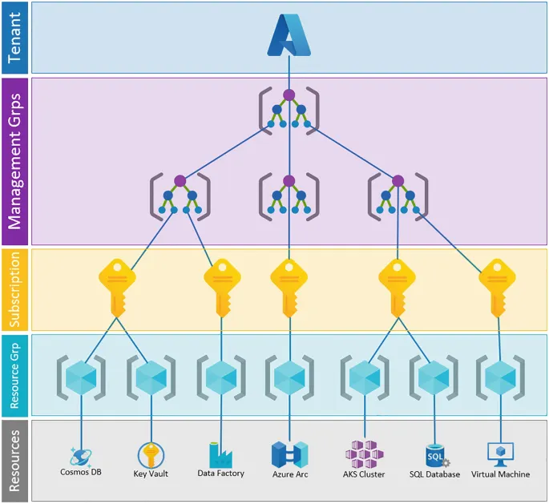
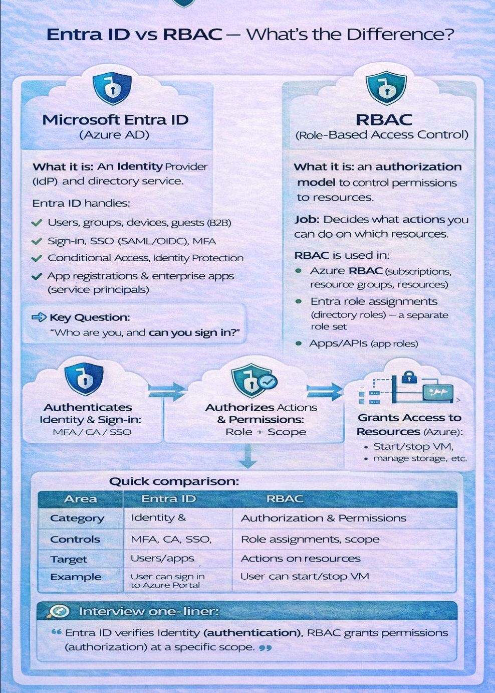

# Module 01: Cloud Governance, Zero-Trust Identity & Financial Guardrails

## 1. Overview & Architectural Context

In an enterprise-grade cloud environment, operational excellence begins before any virtual machine or container is provisioned. Establishing robust **Governance, Zero-Trust Identity, and Cost Guardrails** ensures that infrastructure remains compliant, auditable, secure, and protected against budget overruns.

This module lays the operational foundation for the entire platform, adhering to the **AZ-104 Azure Administrator** standard and enterprise Cloud Operations requirements.

---

<br>


## 2. Azure Management Hierarchy

Azure enforces a strict 4-level hierarchical governance model. Every resource deployed to the platform inherits access controls, compliance rules, and audit configurations from the levels above it.




### Hierarchy Breakdown

| Hierarchy Level | Functional Scope | Cloud-Ops Responsibility |
| :--- | :--- | :--- |
| **Microsoft Entra ID Tenant** | Global Identity Boundary | Centralized user, group, and enterprise application lifecycle management. |
| **Management Groups** | Cross-Subscription Policy Scope | Apply organizational compliance (Azure Policy) and baseline RBAC across multiple subscriptions simultaneously. |
| **Subscriptions** | Billing & Quota Boundary | Tracks cloud expenditures, establishes service limits (vCPU quotas), and isolates environments. |
| **Resource Groups (RG)** | Lifecycle & Logical Grouping | Groups resources that share the same lifecycle (e.g., provisioned, updated, and decommissioned together). |
| **Resources** | Functional Infrastructure | The actual operational instances (e.g., AKS clusters, Managed Disks, VNets). |

> **Operational Insight:** Unlike AWS, where resources reside directly inside an Account, Azure **strictly requires** every single resource to reside within exactly one Resource Group. Deleting a Resource Group triggers a cascading, atomic deletion of all encapsulated resources—preventing orphaned infrastructure and lingering costs.

---


<br>


## 3. Identity vs. Access Management: AuthN vs. AuthZ

Enterprise security requires a strict separation of concerns between identity verification and access permissions:



### 3.1. Anatomy of an Azure RBAC Role Assignment
A role assignment is an immutable tuple consisting of three distinct entities:

$$\text{Role Assignment} = \text{Security Principal} + \text{Role Definition} + \text{Scope}$$

1. **Security Principal:** Who gets the access (`User`, `Security Group`, `Service Principal`, or `Managed Identity`).
2. **Role Definition:** A collection of permissions (`Actions` and `NotActions`).
   * `Owner`: Full access to manage all resources + ability to delegate access to others.
   * `Contributor`: Full access to create and manage resources; cannot grant access to others.
   * `Reader`: View-only access across resources; cannot inspect secrets or connection strings.
   * `Monitoring Contributor`: Cloud-Ops specific role to manage alerts, read logs, and configure diagnostic settings.
   * `Key Vault Secrets User`: Data plane role allowing workload identities to read secrets.
3. **Scope:** The precise boundary where the role applies (`Management Group` $\rightarrow$ `Subscription` $\rightarrow$ `Resource Group` $\rightarrow$ `Resource`).

### 3.2. Scope Inheritance Rule
* Permissions defined at parent scopes are **strictly inherited** by all child scopes.
* **Least Privilege Best Practice:** Never assign broad `Contributor` or `Owner` roles at the Subscription level. Grant access strictly at the **Resource Group** level or to specific functional resources.

---


<br>


## 4. Secretless Workload Architecture with Managed Identities

Hardcoding service credentials, client secrets, or connection strings in application manifests introduces critical security vulnerabilities and operational overhead (secret leakage, certificate expiration outages). 

Azure **Managed Identities** solve this by provisioning automatically managed credentials directly within Microsoft Entra ID.

```
+-------------------------------------------------------------+
| Virtual Machine / Container Workload                        |
|                                                             |
|   [ Application / Daemon ]                                  |
|              │                                              |
|              │ (1) HTTP GET /token                          |
|              ▼                                              |
|   [ Azure Instance Metadata Service (IMDS) ]                |
|     169.254.169.254                                         |
+--------------┬----------------------------------------------+
│
│ (2) Internal Token Request
▼
+-------------------------------------------------------------+
| Microsoft Entra ID                                          |
| (Validates resource identity & returns short-lived JWT)    |
+--------------┬----------------------------------------------+
│
│ (3) Present Bearer Token (Secretless)
▼
+-------------------------------------------------------------+
| Target Resource: Azure Key Vault / Azure SQL Database       |
+-------------------------------------------------------------+
```


